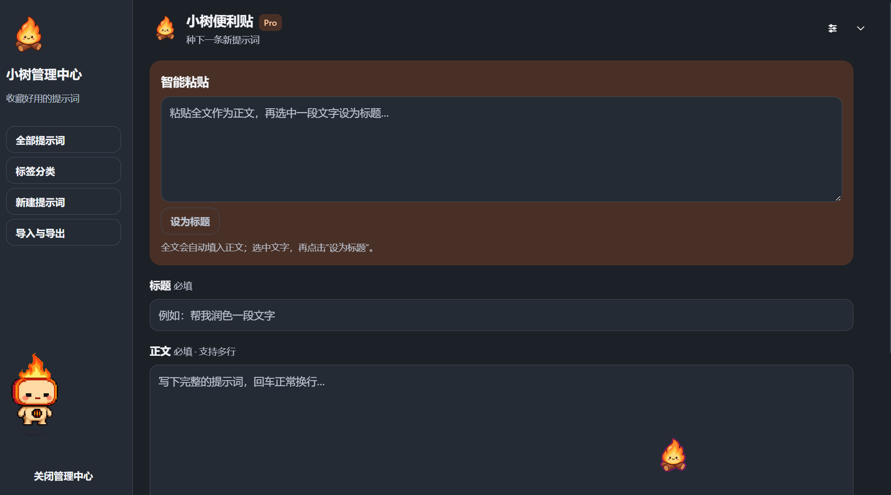
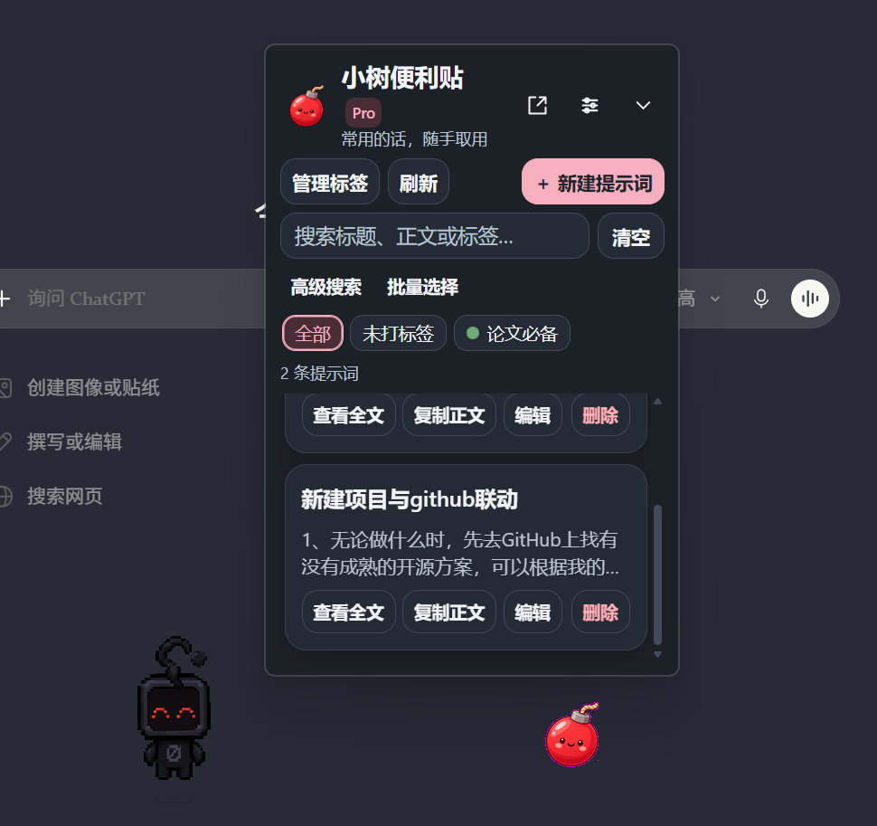
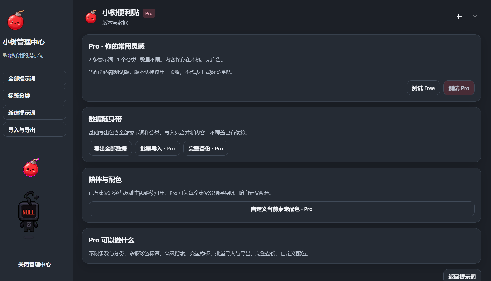

# Little Tree Notes

**Collect useful prompts. Organize them easily. Reuse them anytime.**

Little Tree Notes is a Windows desktop prompt manager independently designed and developed to make saving and reusing AI prompts simple. It combines a lightweight desktop companion, a floating quick-access panel, and a dedicated management window with local-first storage.

## Key Features

- **Desktop companion:** A small desktop pet with selectable appearances and coordinated themes.
- **Quick capture:** Paste the full text of a prompt or a useful note, then select a title directly from the pasted content.
- **Organized collections:** Group saved entries with tags, search by title or content, and manage multiple entries in batches.
- **One-click copying:** Copy saved prompt text for use in ChatGPT and other AI tools.
- **Local-first storage:** Store entries in a local SQLite database.
- **Data portability:** Import and export collections in JSON format.
- **Two workspace views:** Use the floating panel for quick access or open the management center for larger-scale organization.

## Product Screenshots

## Technology Stack

- JavaScript and Node.js
- PowerShell
- C# and Windows Forms
- WebView2
- SQLite
- ChatGPT/Codex integration through MCP
- Skills-only local-execution proof of concept

## Project Contributions

Independently led the product from concept to implementation, including:

- Product positioning, feature planning, and interaction design.
- Development of the desktop companion, floating panel, and management center.
- Implementation of local data storage, prompt collection management, tagging, search, and JSON import/export.
- Integration with the ChatGPT/Codex workflow and validation of local desktop interactions.

## Project Status

The core Windows desktop experience has been implemented and tested locally. Public distribution is still being explored; eligibility for publication in the ChatGPT plugin directory has not yet been confirmed.

---

*Little Tree Notes — Keep your best prompts close at hand.*
